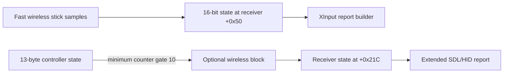

> Earlier research notes. Some status statements predate later tests. See [current results](../docs/results.md).

# GameSir wireless HID: a concrete rate gate found

**Latest October 21 wireless result:** A separately authorized receiver-only patch now removes the extended-native rate clamp and copies native axes from the existing fast receiver buffer. Physical wireless native tests and cold reconnection passed: about 3,979 fresh changed stick states/sec, 0.2498-ms median, full ranges and all four independent extras. Wireless XInput remains about 4 kHz and configuration protocol reads passed. The receiver is left in native HID with the corrected visual tester running. Controller firmware remains the previously validated gate-2 plus wired-native-rate image. See [the final wireless report](wireless-final.md) and its combined final validation. This does not establish effective sensor bits, battery life, extended reliability or downstream Steam/game timing.

**Earlier October 21 wired result:** A separate native extended USB report wait was traced and removed in a controller-only candidate that preserves the earlier gate-2 change. The hardware test passed: 3,999–4,001 fresh native stick states/sec in 22 moving 1-second bins, 0.2491-ms median interval, more than 44,000 distinct output codes per axis, full stick/trigger range, A/B and all four extra buttons. Saved profiles/lighting are byte-identical, and normal wired XInput remains about 4 kHz. The receiver was unchanged at that checkpoint. See [the wired results](wired-final.md); older offline-only statements below are historical.

**October 21 hardware result:** The user requested testing of the existing change. Stock 2.2.9 measured about 100 Hz fresh wireless HID stick states. After flashing the gate-2 experiment, the same receiver interface measured about 472–476 Hz with a 2 ms median interval; all four extra-button bits remained available. Profiles were byte-identical before and after. See [the measured test session](gate2-session.md). Offline-only statements below describe the original October 20 research checkpoint.

Research date: October 20, 2026. Controller firmware 2.2.9 and receiver firmware 1.3.5, taken from the installed GameSir Connect cache.

**The controller contains a minimum-update gate of 10 counter units for the 13-byte state block that feeds the receiver's extended HID report. The counter is advanced by 2 in a callback registered with a period of 2 using the chip vendor's millisecond timer API pattern. This is strong evidence for a deliberate approximately 10 ms / 100 Hz limit in this wireless report path.** It matches the historical capture, but the current firmware and mode still need a fresh live baseline.

I prepared an offline experiment that changes that gate to 2. The application changes by one byte; the vendor assembler confirms the encoding. With the identified timer path, the expected changed-state ceiling moves toward 500 Hz. No modified firmware has been installed, and no improvement has been measured.

## The data path identified

The code contains two distinct stick-state sources in the receiver:



This diagram describes the statically identified paths. It does not establish the fast path's actual runtime activity in every HID mode.

1. The controller constructs a 13-byte state at its main context offset `+0xB88`. This includes buttons, triggers, and four 16-bit axes.
2. At runtime address `0x00108F0A`, it reads a counter at context `+0x132`. At `0x00108F0E`, it skips the changed-state check while that counter is less than 10.
3. Once eligible, a helper compares the 13 bytes with the previous snapshot and copies the new snapshot. If anything changed, or the counter reached 100, the controller sets the pending flag at context `+0x4B4` and clears the counter.
4. The wireless packer at `0x06063FF2` checks that flag and the remaining packet capacity. It clears the pending flag, sets flag `0x40` in the second flag byte, and copies the 13-byte block into the outgoing packet.
5. Receiver code at `0x060439F0` checks the corresponding flag and copies those 13 bytes to its context offset `+0x21C`.
6. The receiver's extended HID builder copies the axes from that block into report bytes 7-14. Its `43 A1 C8` header and big-endian 16-bit axes match the public [SDL GameSir driver](https://github.com/libsdl-org/SDL/blob/main/src/joystick/hidapi/SDL_hidapi_gamesir.c).

Approximate recovered logic, using descriptive names rather than original source symbols:

```c
/* Timer callback, registered with a nominal 2 ms period. */
legacy_state_elapsed += 2;

/* State producer: the 13-byte state is assembled before this gate. */
if (legacy_state_elapsed >= 10) {
    bool changed = compare_and_copy(state13, previous_state13, 13);
    if (changed || legacy_state_elapsed >= 100) {
        pending_state13 = true;
        legacy_state_elapsed = 0;
    }
}

/* Wireless packet packer: other subpackets share this space. */
if (remaining_packet_bytes >= 13 && pending_state13) {
    pending_state13 = false;
    flags2 |= 0x40;
    append(state13, 13);
}
```

The nominal timing identification is supported by the timer registration at `0x0604DAC6`, which passes callback `0x0011F9F6`, period `2`, and priority `1`. The callback increments this counter by 2 at `0x0011FFB8`. The same-chip public [JL703N timer header](https://gitlab.zh-jieli.com/JL-Studio/SoundBox/703N/JL703N_SoundBox_1.0.0/-/blob/SDK_1.0.0_patch_00.13/SDK/interface/system/timer.h) defines `usr_timer_add(..., u32 msec, u8 priority)` and `sys_hi_timer_add` as its priority-1 wrapper. The stripped GameSir binary has not supplied original function names; its wrapper and timer structures are consistent with that API.

## Why the XInput comparison matters

The receiver's XInput builder uses four 16-bit axes at context `+0x50`. Its RAM receive routine updates those from queued eight-byte stick samples. The extended HID builder instead reads the axis bytes from `+0x221` through `+0x228`, inside the separate 13-byte block.

Therefore, observing a high USB report frequency is compatible with seeing only approximately 100 fresh HID axis states per second: the report can be rebuilt or transmitted while this second source remains unchanged. This is a supported explanation, not a new live measurement.

## The offline patch experiment

| Item | Value |
| --- | --- |
| Original application SHA-256 | `fa554844a381e8f43a63aa79c8b86de412893c93c8309c533658c30c6633502d` |
| Instruction runtime address | `0x00108F0E` |
| Instruction application-file offset | `0xE4E7E` |
| Original instruction bytes | `81 F9 13 14` |
| Original instruction | `if (r1 < 10) goto +0x26` |
| Experimental instruction bytes | `81 F9 13 04` |
| Experimental instruction | `if (r1 < 2) goto +0x26` |
| Changed application byte | `0xE4E81`: `14` to `04` |
| Application size | 969,512 bytes, unchanged |
| Experimental application SHA-256 | `a246aa6db7027acb8eff7b1cfc6c1e1371dff1f5ab709a8b0ba7e1c0c06dfd72` |

The official compiler independently assembled both comparisons with the same branch displacement. Disassembling the patched analysis copy confirms that only the comparison value changed. The 100-unit idle-refresh gate and all other application bytes are preserved.

This experiment targets the nominal 10 ms gate only. **It does not establish 1,000 Hz or 8,000 Hz HID input.** The existing 2 ms counter update limits what this threshold-only approach could achieve. Reaching 1,000 Hz would require further work on timing or the fast state path; changing the global timer would affect many unrelated counters and is not the proposed experiment.

The packet packer has a shared byte budget. More frequent full-state blocks could consume space otherwise used by other wireless data. Any eventual device test must check actual fresh updates, packet stability, other modes, audio/gyro behavior, and power impact.

## What was validated offline

- The vendor's official Windows toolchain 2.5.3 was downloaded from its [documented download service](https://doc.zh-jieli.com/Tools/zh-cn/other_info/index.html). Its installer was unpacked into this workspace without running the installer or changing global PATH/registry settings. The extracted compiler and disassembler were used on local analysis files.
- Startup copy loops establish the application memory regions. Some copied “data” contains executable callbacks; including those routines exposed the incoming calls to the HID builder.
- The disassembly's relative-call interpretation was cross-checked against the SDK's ROM `memset` address. The instruction encoding experiment was checked using the vendor assembler and disassembler.
- All four stock firmware packages decode and rebuild byte for byte when no application edit is applied.
- Experimental controller package copies were generated for the Key and No_Key variants. Application CRC, application-area CRC, flash-payload CRC, encrypted entry-table CRC, and container-header CRC were recomputed and checked. Each package differs from its stock counterpart in 26 bytes, including the same application-byte change in both flash payloads and the dependent integrity fields.
- Re-decoding each experimental package extracts the intended experimental application hash. Every non-flash payload remains byte-identical to stock. The installed original package hashes are unchanged.
- These checks cover the integrity mechanisms we identified. They do not establish authorization/signature acceptance by the updater or bootloader, successful recovery, or runtime correctness.

The experimental package copies remain under `work/gamesir_firmware_inspection/experiments/` with `.ufw.research` suffixes. They are untested research artifacts. The output folder contains the findings, evidence, and recording tools, rather than a recommended update image.

## Ready for the next live session

A read-only capture tool is prepared in `gamesir-firmware-research/capture/`. It recognizes the extended GameSir report, parses the signed big-endian axes, and reports USB report arrivals separately from changed stick states. Protocol parsing and repeated-state analysis were checked with synthetic fixtures; it has not been run against the connected controller in this research pass.

The next useful step is a **stock-firmware** native HID capture over the receiver and wired, about 30 seconds of movement each. Confirm the mode and report format first. No firmware update is needed for that baseline. Steam-processed output should then be measured separately; the capture tool explicitly does not label physical HID data as Steam output.

The 100 Hz captures from August had an unconfirmed firmware version. The code evidence now gives a concrete hypothesis for current firmware, while a fresh capture is still needed to confirm that this is the active path on the user's setup.

## Evidence files

- `gamesir-firmware-research/analysis/disassembly-evidence.txt`: relevant original instruction excerpts.
- `gamesir-firmware-research/analysis/assembler-encoding-verification.txt`: independent assembly of both comparisons.
- `gamesir-firmware-research/analysis/experimental-instruction-disassembly.txt`: patched instruction verification.
- `gamesir-firmware-research/analysis/gate-experiment-plan.json`: exact byte, hashes, intent, and limitations.
- `gamesir-firmware-research/analysis/repack-validation.json`: roundtrip and package verification results.
- `gamesir-firmware-research/analysis/controller-regions.json` and `receiver-regions.json`: startup-derived memory maps.
- `gamesir-firmware-research/analysis/xinput-fast-queue-evidence.txt`: follow-up queue reads, with call targets checked against the chip SDK's ROM symbols.
- `gamesir-firmware-research/analysis/polling-precision-calculations.json`: idealized timing and quantization calculations, not device measurements.

[The polling and precision follow-up](polling-and-precision.md) explains the XInput format and diminishing returns. [The resume checkpoint](../README.md) records the next stock-firmware tests.

No controller commands, mode changes, firmware updates, or Steam setting changes were performed during this offline research pass.
